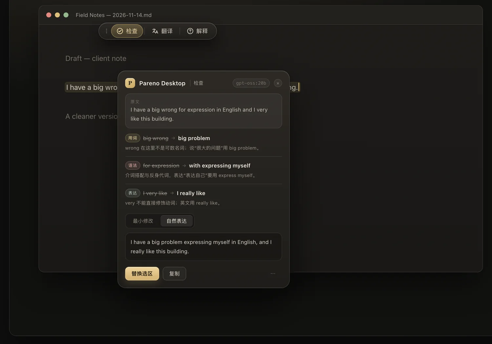

# PARENO · 并言

**Obsidian 插件 + macOS 桌面写作检查器。**

PARENO 把检查、翻译、解释放进你正在写的地方：Obsidian 里是侧栏，macOS 上是贴着光标的一条 HUD。每条建议先给出原句、理由和可编辑的修改稿，是否采纳始终由你决定。

- **官网**：https://pareno.altn.vision
- **Pareno Desktop**：https://pareno.altn.vision/desktop/
- **Obsidian 安装**：https://pareno.altn.vision/install/
- **反馈**：https://github.com/Jorgut/pareno/issues

<p align="center">
  <a href="https://pareno.altn.vision/desktop/"></a>
  <a href="https://pareno.altn.vision/install/"></a>
</p>

## 两个版本

| | Pareno Desktop | Pareno for Obsidian |
| --- | --- | --- |
| 位置 | 任意 App 的光标旁 | Obsidian 正文与侧栏 |
| 入口 | 菜单栏 HUD、⌥⌘G | 侧栏、命令面板 |
| 适合 | 邮件、文档、聊天、网页输入 | 长文、双语笔记、全文审校 |
| 版本 | 0.9.22 | 0.9.0 |
| 系统 | macOS 13+，Universal | Obsidian 桌面版 1.5.0+ |
| 获取 | [下载 DMG](https://github.com/Jorgut/pareno/releases/download/desktop-0.9.22/ParenoDesktop-0.9.22.dmg) | [安装说明](https://pareno.altn.vision/install/) |

### Pareno Desktop

- 在 TextEdit、Chrome、Slack、邮件等任意可输入文字的地方出现
- 检查 / 翻译 / 解释，结果卡贴着 HUD 展开
- 中文 / English / Русский
- 默认连接本机 Ollama，可离线；也支持云端模型
- 已 Developer ID 签名、Apple 公证

首次打开需要在 **系统设置 → 隐私与安全性 → 辅助功能** 手动点 `+` 添加 Pareno Desktop，并用 Touch ID 确认。还没有上架 Mac App Store，直接下载 DMG 安装。

### Pareno for Obsidian

- 正文批注、全文审校、翻译、中英核对、作者风格、写作对话
- 每条建议都可编辑；替换可以用 Obsidian 撤销恢复
- 本地 Ollama、云端 Ollama、本机 Agent CLI（Codex / Claude Code / Cursor Agent / OpenCode）、兼容 API
- 通过 BRAT 或手动复制插件文件安装

## 仓库结构

```text
src/                 Obsidian 插件（TypeScript）
desktop/             Pareno Desktop（Swift / SwiftUI + AppKit）
website/             官网（Astro + Cloudflare Pages）
skills/              写作 skill
main.js / manifest.json / styles.css   Obsidian 发布文件
```

## 写作 skill 与插件

本仓库同时保存 [PARENO Writing skill](skills/pareno-writing/SKILL.md) 和 PARENO 插件源码，作为两者的统一维护位置。skill 指导支持它的 AI 编码助手完成研究、双语改编、编辑与学习反馈；插件提供 Obsidian 正文标注、侧栏审校和替换操作。

插件构建时使用由 `SKILL.md` 生成的写作规则：中英改编规则用于翻译与核对，编辑规则用于审校、作者风格、解释和写作对话。修改 skill 后运行 `npm run sync:skill`，再执行测试与构建；检查脚本会阻止未同步的规则进入构建。插件不会在运行时读取本机的 skill 文件，任务指令仍由插件源码维护。安装 skill 时，将 `skills/pareno-writing/` 复制到所用 AI 助手的 skills 目录；安装插件则按下文步骤操作。

本机项目目录名为 `PARENO`。插件源码在 `src/`，写作 skill 在 `skills/pareno-writing/`；本地研究、QA 和原型资料放在不提交到 GitHub 的 `docs/local/`。插件发布文件仍位于仓库根目录。

## 现在可以做什么

| 写作任务 | 如何使用 | 结果 |
| --- | --- | --- |
| 选区或段落检查 | 在正文选中文字，或把光标放在段落内，选择「检查与润色」 | 区分明确错误与可选表达；正文出现可点击标注，侧栏提供最小修改、自然表达及中文解释 |
| 全文审校 | 选择「整篇文章」和「检查与润色」，再点「开始审校」 | 跳过元数据、标题、图片和代码块，分批审校；侧栏结果定位到正文的圆角标记 |
| 翻译 | 选择「翻译」 | 忠实译法和自然表达两版，译文可编辑后插入原文下方 |
| 中英核对 | 选中成对的中英段落，选择「核对中英」 | 检查原意、遗漏、术语和证据强度；只给建议，不自动替换双语原文 |
| 解释表达 | 选择「解释表达」 | 用中文说明语法、词汇和可复用句型 |
| 作者风格 | 选择「作者风格」 | 指出空泛表达、重复转折和论点力度，尽量保留作者声音 |
| 写作对话 | 在侧栏底部输入具体要求 | 围绕当前选区或段落对话；修改稿可编辑、确认后替换；记录写入本库 `PARENO/Conversations/` |

点击正文标记可查看原句、解释、局部修改及可选整段表达。原文改变后，旧标记会失效；替换可以用 Obsidian 的撤销操作恢复。学习卡片单独写入 `PARENO/Learning Log.md`。

Pangram AI 文本检测仍保留为**手动、可选的独立工具**。只有主动点击检测时，当前整篇笔记才会发送给 Pangram；需要独立 API 密钥并可能产生费用。分类结果是估计，不是作者身份的证明。

## 安装

### 通过 BRAT 安装（推荐，可更新）

1. 在 Obsidian → **设置 → 第三方插件 → 浏览**，安装 **BRAT**（Obsidian42 - BRAT）。
2. 命令面板运行 **BRAT: Add a beta plugin for testing**，输入 `Jorgut/pareno`。
3. BRAT 会安装最新 GitHub Release；以后在 BRAT 里检查更新，点一下即可升级。

已有手动安装的 PARENO 时，BRAT 会接管同一个 `.obsidian/plugins/pareno/` 目录；升级前建议备份旧文件和设置。

### 手动安装

1. 在 GitHub 选择 **Code → Download ZIP** 并解压。
2. 将仓库根目录的 `main.js`、`manifest.json`、`styles.css` 复制到你的库：`.obsidian/plugins/pareno/`。
3. Obsidian → **设置 → 第三方插件**，启用 **PARENO**。已有 PARENO 安装者先备份旧版插件文件与设置。
4. 点击左侧语言图标打开侧栏。在 **PARENO 设置**里选择模型供应方式。

`0.9.0` 起支持 **Obsidian 移动端（iOS / Android）**，桌面端功能不变。桌面版包含本机 Codex、Claude Code、Cursor Agent、OpenCode 的 CLI 接入，以及 Ollama 本机与云端模型；手机上没有本机 Ollama 和 CLI，移动端请使用 **Ollama 云端（ollama.com 密钥）** 或 **兼容 Chat Completions API**，插件在移动端会自动隐藏桌面专属入口。

它不会删除或迁移旧 Archintera Writing Companion 的文件和学习记录；两个插件若同时启用，可能同时显示各自侧栏，建议验证新版本后再停用旧插件。

### 模型选择

- **Ollama · 本机 / 云端**：默认。本机模型直接连接 `http://localhost:11434/v1/chat/completions`，默认 `qwen2.5:7b`；也可加载 ollama.com 的云端模型目录（含免费额度模型），选择云端模型时需要填写 ollama.com API 密钥（在 [ollama.com/settings/keys](https://ollama.com/settings/keys) 创建），请求会发送到 `https://ollama.com`。也可以先在终端运行 `ollama signin`，让云端模型经本机 Ollama 转发；登录后它们会出现在本机模型列表中。本机模型的英文质量取决于所选模型。
- **本机 Agent · Codex / Claude Code / Cursor Agent / OpenCode**：插件自动检测本机已安装的 CLI 并显示版本，使用各 CLI 已有的登录，不读取或复制令牌。可在设置里为每个 CLI 填完整路径；模型留空使用该 Agent 的默认模型。这些调用会把本次文本发送到对应 Agent 的云服务；Codex 工作流**不会同步到 ChatGPT 网站的 Project 或对话记录**。
- **云端 · 兼容 API**：填写 Chat Completions 端点、模型和 API 密钥。API 费用与订阅分开计算。密钥保存在本库插件设置中，不要把该设置提交到公开仓库。

不会从本地模型静默切换到云端。侧栏显示当前模型与发送范围；全文审校须单独选择并点击开始。自动段落审校默认关闭。

## 快捷键与工作流

命令面板搜索 `PARENO`，可使用 **Review selected text / current paragraph**、**Review current article**、**Translate**、**Compare Chinese and English meaning**、**Explain**、**Author voice review** 等命令。到 **设置 → 快捷键** 可自行绑定按键。侧栏对话用 `⌘ / Ctrl + Enter` 发送。

1. 选中内容，或将光标放在段落中。
2. 选择检查范围、任务和模型，点击「开始审校」。
3. 点击正文标注或侧栏列表，阅读原因；可编辑修改稿。
4. 确认替换、保留原文或保存学习卡片。

全文审校最多处理 25 个批次。大型文章请分章节检查。它是语言与表达辅助，不会自动核实报道事实、引用和建筑技术参数。

## 隐私与记录

- 段落任务只发送选区或当前段落；全文任务分批发送文章正文。只有作者主动启动，或在设置中开启自动审校时，才会调用模型。
- 本机 Ollama 只在本机运行；Ollama 云端模型、本机 Agent（Codex / Claude Code / Cursor Agent / OpenCode）和兼容 API 会把本次文本发送到各自服务。Pangram 是独立的主动付费扫描。
- 写作对话按文章保存到本库 `PARENO/Conversations/`；学习卡片保存到 `PARENO/Learning Log.md`。这些文件可能随你的 Obsidian 同步方案同步。
- PARENO 不收集分析遥测。插件内的历史记录不等同于 ChatGPT Project 同步。

## 反馈问题

使用中遇到问题时，可以直接从插件里反馈：

- 侧栏底部点击「反馈问题 ↗」，或在 **设置 → PARENO → 反馈与支持** 里打开反馈窗口。
- 填写反馈类型、问题描述和可选邮箱后点「提交反馈」；反馈经官网 `/api/feedback` 发送到作者的**私有 GitHub 收件库**，**不需要 GitHub 账号**。
- 提交服务不可用时，可以「复制反馈内容」粘贴到邮件或微信，或「在 GitHub 提交」公开 issue。
- 反馈只附带 PARENO 与 Obsidian 版本、平台、模型方式与名称、写作语体和自动审校状态；不会包含笔记内容、文件路径或 API 密钥，只有主动点击提交才会发送。

反馈接口的字段、隐私边界和部署步骤见 [docs/FEEDBACK.md](docs/FEEDBACK.md) 与 [docs/DEPLOY-CLOUDFLARE.md](docs/DEPLOY-CLOUDFLARE.md)。也可以直接在 [GitHub Issues](https://github.com/Jorgut/pareno/issues) 提交。

## 官网

官网：https://pareno.altn.vision

源码在 `website/`（Astro 静态站 + Cloudflare Pages Function 反馈接口），与插件共用反馈收件库。本地构建与部署步骤见 [docs/DEPLOY-CLOUDFLARE.md](docs/DEPLOY-CLOUDFLARE.md)。

## 开发

需要 Node.js 20 或更新版本。

```bash
npm ci
npm run typecheck
npm test
npm run build
```

构建产物是仓库根目录的 `main.js`。如要进行界面测试，请在演示库/演示笔记上先验证，不要直接把未审查的建议用于已发表文章。

## Desktop 开发

```bash
cd desktop
swift build
swift run ParenoDesktop --selftest

# 打包、签名、公证产物见 docs/product/pareno-direct-plan.md
./scripts/build-app.sh
./scripts/build-dmg.sh
```

Desktop 的签名、公证、DMG、Sparkle 更新和 Paddle 接入计划见 [docs/product/pareno-direct-plan.md](docs/product/pareno-direct-plan.md)；当前发布记录见 [Releases](https://github.com/Jorgut/pareno/releases)。

## License

- **Obsidian 插件、website、写作 skill**：MIT，见 [LICENSE](LICENSE)。
- **Pareno Desktop**：专有软件，源码仅用于开发、审计与构建官方版本；未经许可不得再分发或用于商业产品。见 [desktop/LICENSE](desktop/LICENSE)。
