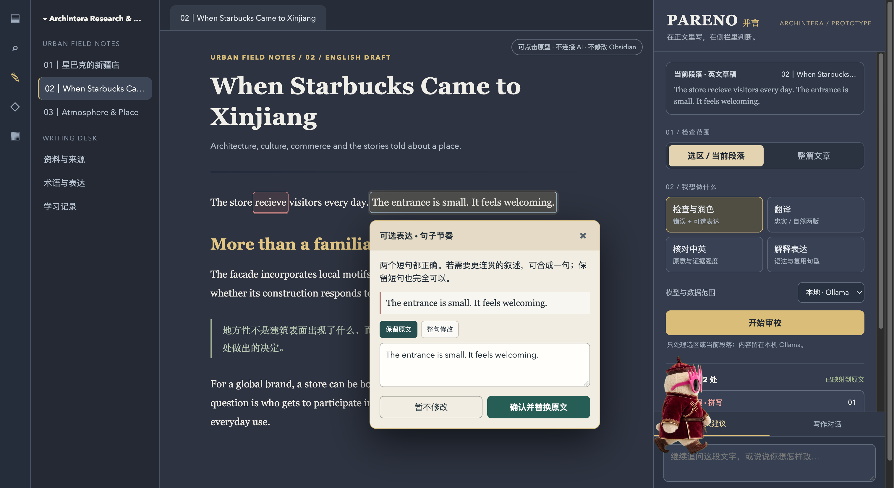

# PARENO · 并言

**在正文里写，在侧栏里判断。** PARENO 是 Archintera 的 Obsidian 双语写作助手。它把原 Archintera Writing Companion 的正文批注与全文审校，和 PARENO 的翻译、表达解释、作者风格、学习记录整合到一个插件中。

编辑建议始终由作者决定：看到原句、修改理由和可编辑的建议稿之后，才确认替换。写作过程不需要离开 Obsidian。

> 当前为 GitHub 源码版 `0.6.0`，尚未上架 Obsidian Community Plugins。界面仍在迭代。

## 界面方向



*这是 2026-11-02 的交互原型截图，用于展示目标布局与操作方式；它不是插件实机截图。截图中的宠物属于桌面环境，不是 PARENO 功能。实际插件界面以安装后的版本为准。*

## 写作 skill 与插件

本仓库同时保存 [PARENO Writing skill](skills/pareno-writing/SKILL.md) 和 PARENO 插件源码，作为两者的统一维护位置。skill 指导支持它的 AI 编码助手完成研究、双语改编、编辑与学习反馈；插件提供 Obsidian 正文标注、侧栏审校和替换操作。

插件构建时使用由 `SKILL.md` 生成的写作规则：中英改编规则用于翻译与核对，编辑规则用于审校、作者风格、解释和写作对话。修改 skill 后运行 `npm run sync:skill`，再执行测试与构建；检查脚本会阻止未同步的规则进入构建。插件不会在运行时读取本机的 skill 文件，任务指令仍由插件源码维护。安装 skill 时，将 `skills/pareno-writing/` 复制到所用 AI 助手的 skills 目录；安装插件则按下文步骤操作。

本机项目目录名为 `PARENO`。插件源码在 `src/`，写作 skill 在 `skills/pareno-writing/`；本地研究、QA 和原型资料放在不提交到 GitHub 的 `docs/local/`。插件发布文件仍位于仓库根目录。

## 现在可以做什么

| 写作任务 | 如何使用 | 结果 |
| --- | --- | --- |
| 选区或段落检查 | 在正文选中文字，或把光标放在段落内，选择「检查与润色」 | 区分明确错误与可选表达；正文出现可点击标注，侧栏提供最小修改、自然表达及中文解释 |
| 全文审校 | 选择「整篇文章」和「检查与润色」，再点「开始审校」 | 跳过元数据、标题、图片和代码块，分批审校；侧栏结果定位到正文的圆角标记 |
| 翻译 | 选择「翻译」 | 忠实译法和自然表达两版，译文可编辑后插入原文下方 |
| 中英核对 | 选中成对的中英段落，选择「核对中英」 | 检查原意、遗漏、术语和证据强度；只给建议，不自动替换双语原文 |
| 解释表达 | 选择「解释表达」 | 用中文说明语法、词汇和可复用句型 |
| 作者风格 | 选择「作者风格」 | 指出空泛表达、重复转折和论点力度，尽量保留作者声音 |
| 写作对话 | 在侧栏底部输入具体要求 | 围绕当前选区或段落对话；修改稿可编辑、确认后替换；记录写入本库 `PARENO/Conversations/` |

点击正文标记可查看原句、解释、局部修改及可选整段表达。原文改变后，旧标记会失效；替换可以用 Obsidian 的撤销操作恢复。学习卡片单独写入 `PARENO/Learning Log.md`。

Pangram AI 文本检测仍保留为**手动、可选的独立工具**。只有主动点击检测时，当前整篇笔记才会发送给 Pangram；需要独立 API 密钥并可能产生费用。分类结果是估计，不是作者身份的证明。

## 安装

### 通过 BRAT 安装（推荐，可更新）

1. 在 Obsidian → **设置 → 第三方插件 → 浏览**，安装 **BRAT**（Obsidian42 - BRAT）。
2. 命令面板运行 **BRAT: Add a beta plugin for testing**，输入 `Jorgut/pareno`。
3. BRAT 会安装最新 GitHub Release；以后在 BRAT 里检查更新，点一下即可升级。

已有手动安装的 PARENO 时，BRAT 会接管同一个 `.obsidian/plugins/pareno/` 目录；升级前建议备份旧文件和设置。

### 手动安装

1. 在 GitHub 选择 **Code → Download ZIP** 并解压。
2. 将仓库根目录的 `main.js`、`manifest.json`、`styles.css` 复制到你的库：`.obsidian/plugins/pareno/`。
3. Obsidian → **设置 → 第三方插件**，启用 **PARENO**。已有 PARENO 安装者先备份旧版插件文件与设置。
4. 点击左侧语言图标打开侧栏。在 **PARENO 设置**里选择模型供应方式。

这是桌面版插件。`0.6.0` 包含本机 Codex CLI 接入，因此清单标记为 desktop-only。它不会删除或迁移旧 Archintera Writing Companion 的文件和学习记录；两个插件若同时启用，可能同时显示各自侧栏，建议验证新版本后再停用旧插件。

### 模型选择

- **本地 · Ollama**：默认。先安装 Ollama 和模型（默认 `qwen2.5:7b`），再启动 Ollama。PARENO 默认连接 `http://localhost:11434/v1/chat/completions`。本地模型的英文质量取决于所选模型。
- **云端 · Codex 登录**：使用电脑上已登录的 `codex` CLI，不读取或复制登录令牌。可在设置里填 CLI 的完整路径。这是 Codex CLI 工作流，**不会同步到 ChatGPT 网站的 Project 或对话记录**。
- **云端 · 兼容 API**：填写 Chat Completions 端点、模型和 API 密钥。API 费用与 ChatGPT 订阅分开计算。密钥保存在本库插件设置中，不要把该设置提交到公开仓库。

不会从本地模型静默切换到云端。侧栏显示当前模型与发送范围；全文审校须单独选择并点击开始。自动段落审校默认关闭。

## 快捷键与工作流

命令面板搜索 `PARENO`，可使用 **Review selected text / current paragraph**、**Review current article**、**Translate**、**Compare Chinese and English meaning**、**Explain**、**Author voice review** 等命令。到 **设置 → 快捷键** 可自行绑定按键。侧栏对话用 `⌘ / Ctrl + Enter` 发送。

1. 选中内容，或将光标放在段落中。
2. 选择检查范围、任务和模型，点击「开始审校」。
3. 点击正文标注或侧栏列表，阅读原因；可编辑修改稿。
4. 确认替换、保留原文或保存学习卡片。

全文审校最多处理 25 个批次。大型文章请分章节检查。它是语言与表达辅助，不会自动核实报道事实、引用和建筑技术参数。

## 隐私与记录

- 段落任务只发送选区或当前段落；全文任务分批发送文章正文。只有作者主动启动，或在设置中开启自动审校时，才会调用模型。
- Ollama 在本机运行。Codex CLI 和兼容 API 会将本次文本发送到相应服务。Pangram 是独立的主动付费扫描。
- 写作对话按文章保存到本库 `PARENO/Conversations/`；学习卡片保存到 `PARENO/Learning Log.md`。这些文件可能随你的 Obsidian 同步方案同步。
- PARENO 不收集分析遥测。插件内的历史记录不等同于 ChatGPT Project 同步。

## 反馈问题

使用中遇到问题时，可以直接从插件里反馈：

- 侧栏底部点击「反馈问题 ↗」，或在 **设置 → PARENO → 反馈与支持** 里打开反馈窗口。
- 填写反馈类型、问题描述和可选邮箱后点「提交反馈」；反馈经官网 `/api/feedback` 发送到作者的**私有 GitHub 收件库**，**不需要 GitHub 账号**。
- 提交服务不可用时，可以「复制反馈内容」粘贴到邮件或微信，或「在 GitHub 提交」公开 issue。
- 反馈只附带 PARENO 与 Obsidian 版本、平台、模型方式与名称、写作语体和自动审校状态；不会包含笔记内容、文件路径或 API 密钥，只有主动点击提交才会发送。

反馈接口的字段、隐私边界和部署步骤见 [docs/FEEDBACK.md](docs/FEEDBACK.md) 与 [docs/DEPLOY-CLOUDFLARE.md](docs/DEPLOY-CLOUDFLARE.md)。也可以直接在 [GitHub Issues](https://github.com/Jorgut/pareno/issues) 提交。

## 官网

官网：https://parenowriter.pages.dev

源码在 `website/`（Astro 静态站 + Cloudflare Pages Function 反馈接口），与插件共用反馈收件库。本地构建与部署步骤见 [docs/DEPLOY-CLOUDFLARE.md](docs/DEPLOY-CLOUDFLARE.md)。

## 开发

需要 Node.js 20 或更新版本。

```bash
npm ci
npm run typecheck
npm test
npm run build
```

构建产物是仓库根目录的 `main.js`。如要进行界面测试，请在演示库/演示笔记上先验证，不要直接把未审查的建议用于已发表文章。

## License

MIT，见 [LICENSE](LICENSE)。
